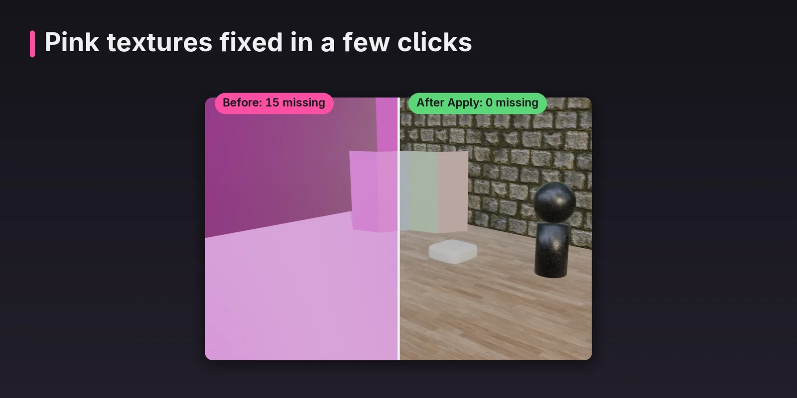
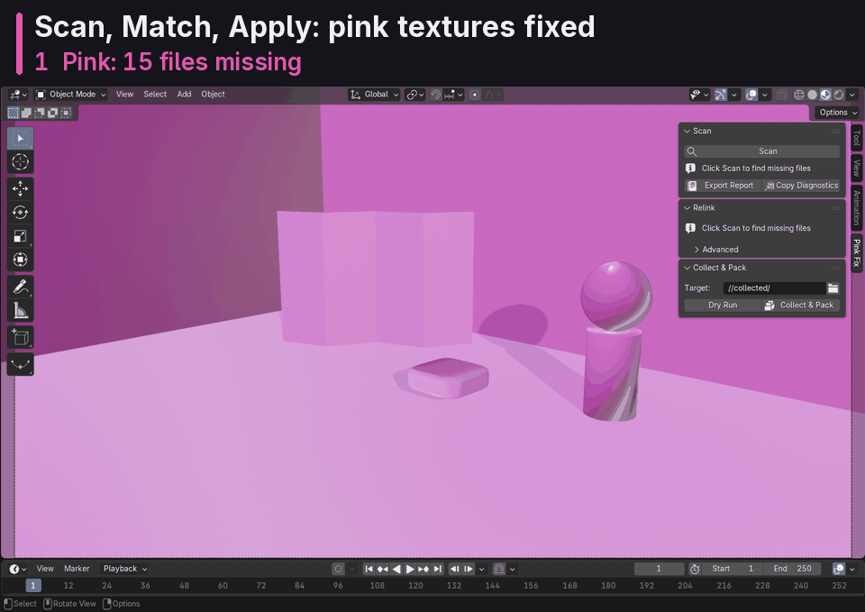
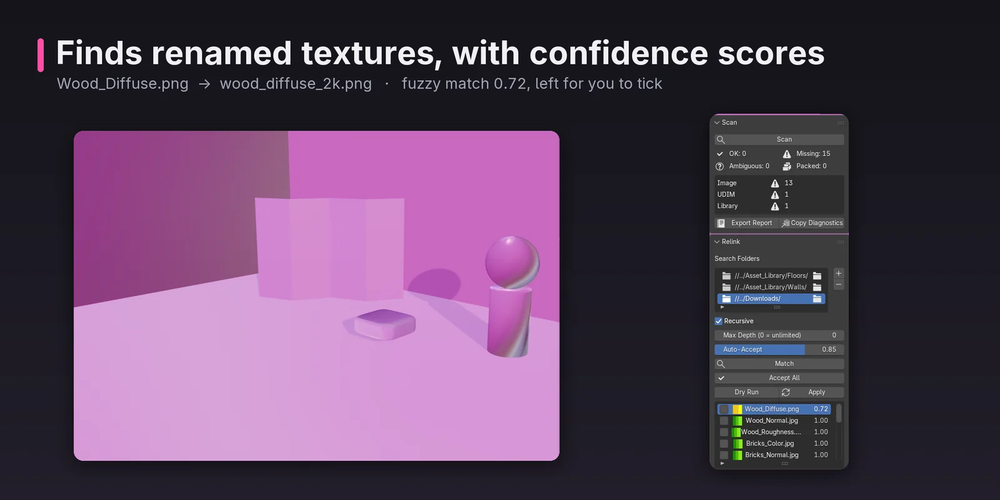
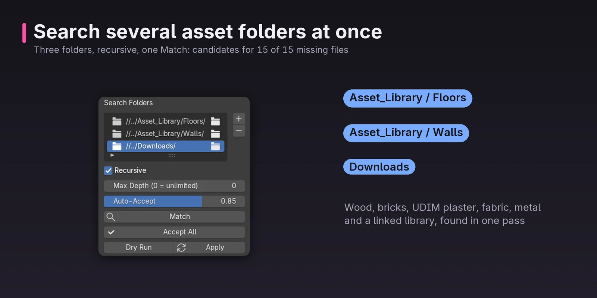
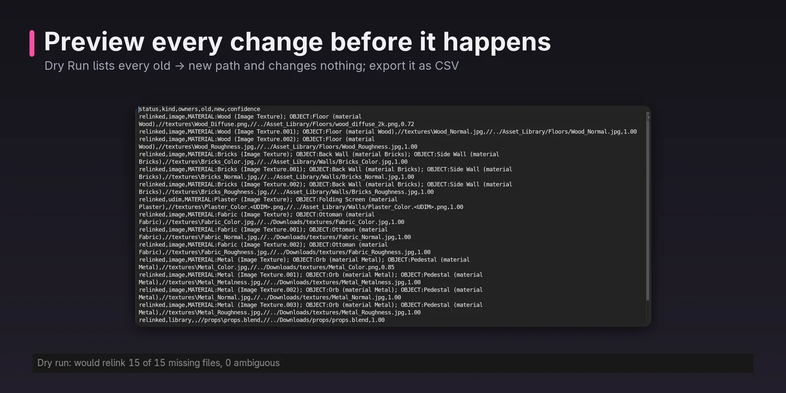
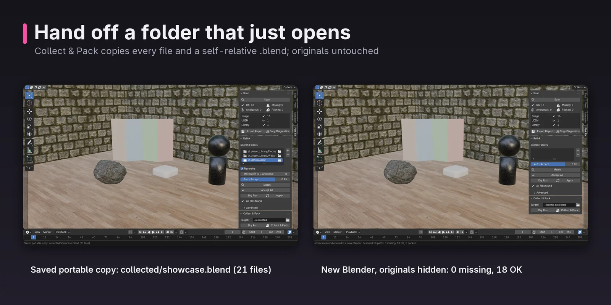
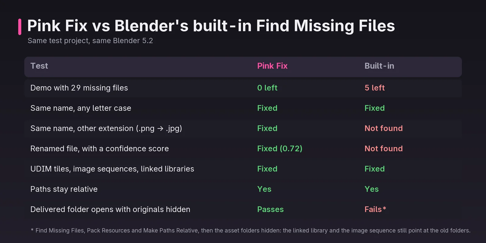

# Showcase

Pink Fix on a real test project in Blender 5.2: scan, match, apply, and hand off a folder that just opens.

<figure markdown="span">
  { loading=lazy }
  <figcaption>Pink textures fixed in a few clicks</figcaption>
</figure>

<figure markdown="span">
  { loading=lazy }
  <figcaption>Scan, Match, Apply</figcaption>
</figure>

<figure markdown="span">
  { loading=lazy }
  <figcaption>Finds renamed textures, with confidence scores</figcaption>
</figure>

<figure markdown="span">
  { loading=lazy }
  <figcaption>Search several asset folders at once</figcaption>
</figure>

<figure markdown="span">
  { loading=lazy }
  <figcaption>Preview every change before it happens</figcaption>
</figure>

<figure markdown="span">
  { loading=lazy }
  <figcaption>Hand off a folder that just opens</figcaption>
</figure>

<figure markdown="span">
  { loading=lazy }
  <figcaption>Pink Fix vs Blender's built-in Find Missing Files</figcaption>
</figure>
